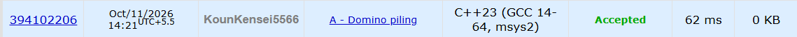

# 🚀 POTD Challenge - Day 11

## 🧩 Problem: Domino piling

- **Difficulty:** 800 Rating

---

## 📌 Problem

You are given a rectangular board of size `M × N` and an unlimited number of dominoes, each covering exactly two adjacent squares. Dominoes can be rotated but must remain entirely inside the board without overlapping.

Determine the maximum number of dominoes that can be placed on the board.

### Example

**Input:**
```text
2 4
```

**Output:**
```text
4
```

---

## ⏱️ Time Complexity

**O(1)**

---

## 💾 Space Complexity

**O(1)**

---

## 💻 Solution

```cpp
#include <iostream>
using namespace std;

int main() {

    int m,n;
    cin>>n>>m;

    cout<<(m*n) / 2<<endl;

    return 0;
}
```

---

## 📸 Acceptance Screenshot

