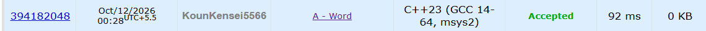

# 🚀 POTD Challenge - Day 12

## 🧩 Problem: Word

- **Difficulty:** 800 Rating

---

## 📌 Problem

Given a word containing uppercase and lowercase English letters, convert it entirely to uppercase or lowercase by changing the minimum number of letters.

- If the word contains more uppercase letters, convert it to uppercase.
- Otherwise, convert it to lowercase. If both counts are equal, use lowercase.

### Example

**Input:**
```text
HoUse
```

**Output:**
```text
house
```

---

## ⏱️ Time Complexity

**O(n)**

---

## 💾 Space Complexity

**O(1)** 

---

## 💻 Solution

```cpp
#include <iostream>
#include <cctype>
#include <algorithm>
using namespace std;

int main() {

    string s;
    cin >> s;

    int lowerCase = 0;
    int upperCase = 0;

    for(char c : s) {

        if(isupper(c)) {
            upperCase++;
        } else {
            lowerCase++;
        }
    }

    if(upperCase <= lowerCase) {
        transform(s.begin(), s.end(), s.begin(), ::tolower);
    } else {
        transform(s.begin(), s.end(), s.begin(), ::toupper);
    }

    cout << s << endl;

    return 0;
}
```

---

## 📸 Acceptance Screenshot

