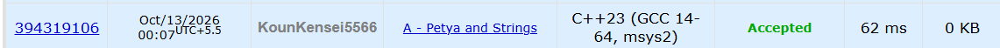

# 🚀 POTD Challenge - Day 13

## 🧩 Problem: Petya and Strings

- **Difficulty:** 800 Rating

---

## 📌 Problem

Given two strings of equal length containing uppercase and lowercase English letters, compare them lexicographically without considering letter case.

Print `-1` if the first string is smaller, `1` if the second string is smaller, or `0` if both strings are equal.

### Example

**Input:**
```text
abs
Abz
```

**Output:**
```text
-1
```

---

## ⏱️ Time Complexity

**O(n)**

---

## 💾 Space Complexity

**O(n)**

---

## 💻 Solution

```cpp
#include <iostream>
#include <algorithm>
using namespace std;

int main() {

    string s1, s2;
    cin >> s1 >> s2;

    int l = s1.length();

    transform(s1.begin(), s1.end(), s1.begin(), ::tolower);
    transform(s2.begin(), s2.end(), s2.begin(), ::tolower);

    for(int i = 0; i < l; i++) {
        if(s1[i] < s2[i]) {
            cout << -1 << endl;
            return 0;
        }

        else if(s1[i] > s2[i]) {
            cout << 1 << endl;
            return 0;
        }
    }

    cout << 0 << endl;

    return 0;
}
```

---

## 📸 Acceptance Screenshot

