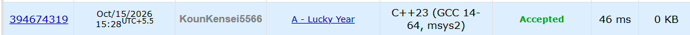

# 🚀 POTD Challenge - Day 5

## 🧩 Problem: Lucky Year

- **Difficulty:** 900 Rating

---

## 📌 Problem

A year is considered lucky if its number contains at most one non-zero digit. Given the current year `n`, determine how many years residents must wait until the next lucky year.

### Example

**Input:**
```text
201
```

**Output:**
```text
99
```

---

## ⏱️ Time Complexity

**O(log n)** — Converting the number to a string takes time proportional to the number of digits.

---

## 💾 Space Complexity

**O(log n)** — The string stores the digits of the input number.

---

## 💻 Solution

```cpp
#include <iostream>
#include <string>
#include <algorithm>
#include <cmath>
using namespace std;

int main() {

    int n;
    cin>>n;

    if(n <= 9) {
        cout<<1;
        return 0;
    }

    string numStr = to_string(n);
    int l = numStr.length();

    int divisor = pow(10, l-1);

    int r = n % divisor;

    int nextMultipleOf10 = (n-r) + (pow(10, l-1));

    cout<<nextMultipleOf10 - n;

    return 0;

}
```

---

## 📸 Acceptance Screenshot

