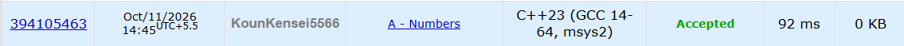

# 🚀 POTD Challenge - Day 11

## 🧩 Problem: Numbers

- **Difficulty:** 1000 Rating

---

## 📌 Problem

Given an integer `A`, calculate the average sum of its digits when represented in every base from `2` to `A - 1`.

Output the average as an irreducible fraction `X/Y`, where `X` is the numerator and `Y` is the denominator.

### Example

**Input:**
```text
5
```

**Output:**
```text
7/3
```

---

## ⏱️ Time Complexity

**O(A log A)**

---

## 💾 Space Complexity

**O(1)**

---

## 💻 Solution

```cpp
#include <iostream>
using namespace std;

int gcd(int a, int b) {

    if(b == 0) return a;

    return gcd(b, a % b);
}

int main() {

    int A;
    cin >> A;

    int sum = 0;

    for(int i = 2; i < A; i++) {

        int n = A;
        int digitSum = 0;

        while(n > 0) {
            digitSum += (n % i);
            n /= i;
        }

        sum += digitSum;
    }

    int gcd_of_sum_and_A = gcd(sum, A - 2);

    cout << sum / gcd_of_sum_and_A << "/" << (A - 2) / gcd_of_sum_and_A << endl;

    return 0;
}
```

---

## 📸 Acceptance Screenshot

